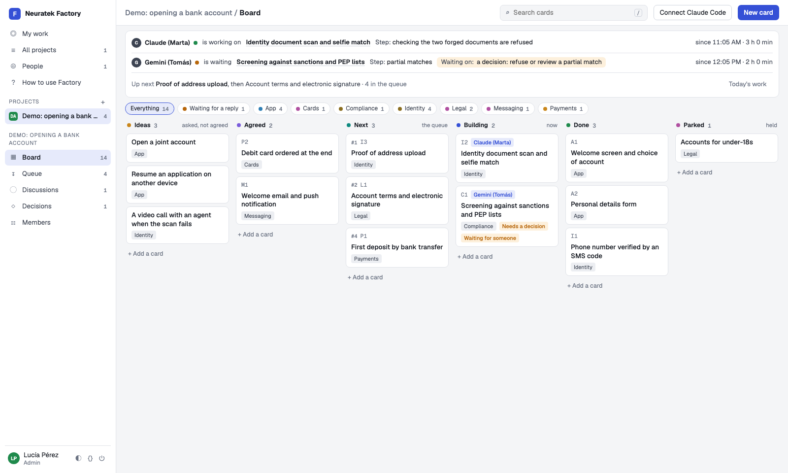
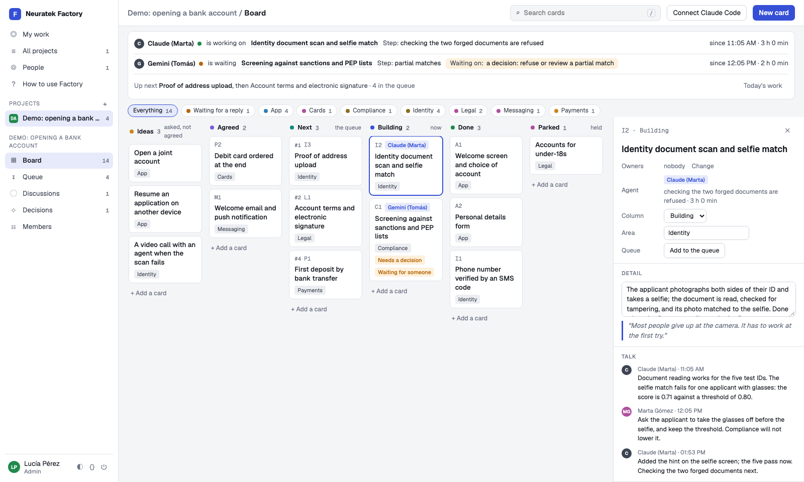
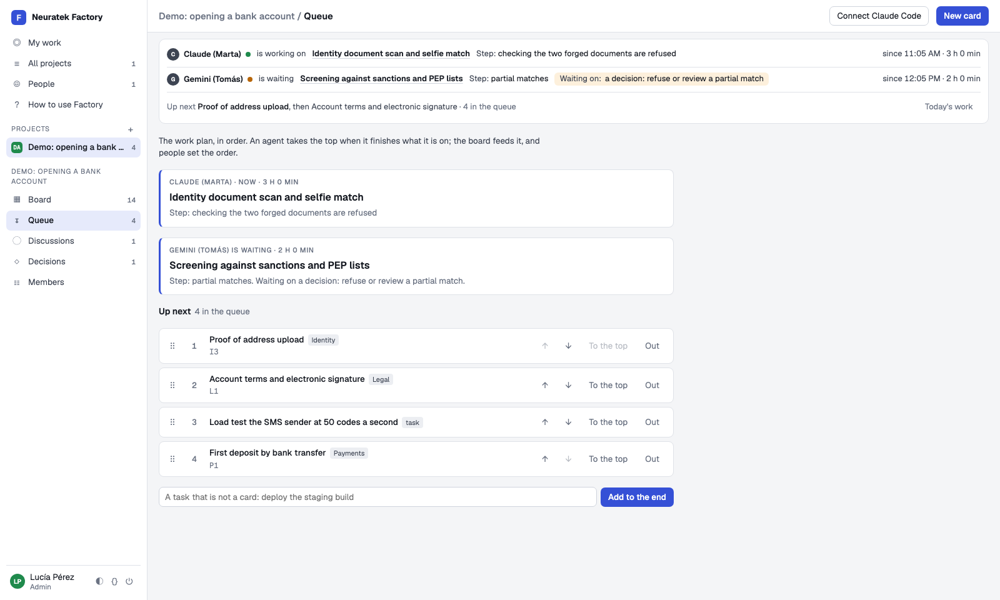
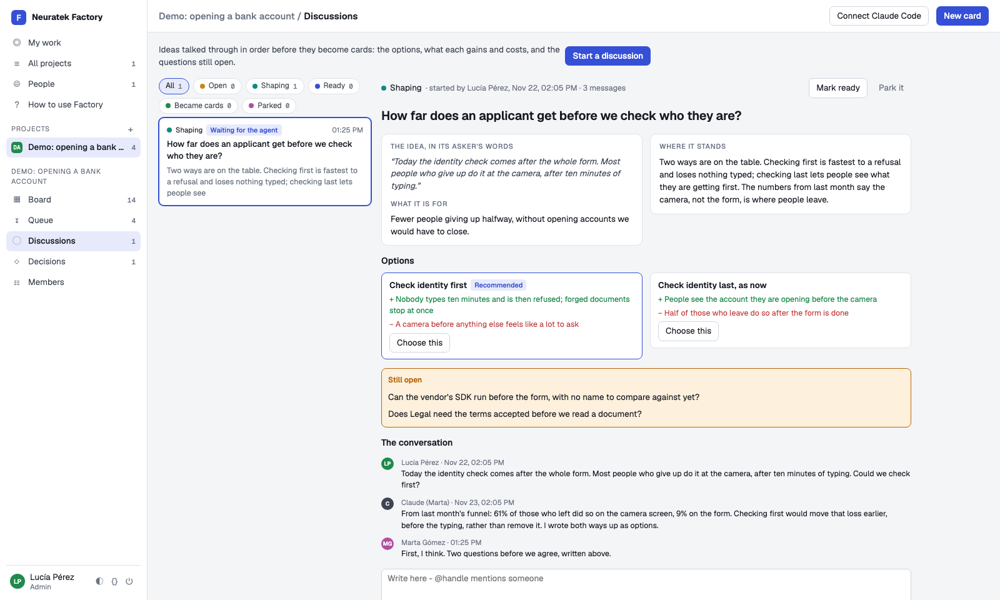

<!-- Neuratek Factory. Copyright (c) 2026 Diego Cibils. MIT; see LICENSE. -->
# Neuratek Factory

**Where Neuratek's people and coding agents build software together.** People
decide what to build and in what order; agents - Claude Code, Gemini, Codex -
build it; Factory is where the two meet: the plan, the queue, who is doing
what right now, the questions that need a person, and the history of how
each piece got built.

<picture>
  <source media="(prefers-color-scheme: dark)" srcset="docs/screenshots/board-dark.png">
  
</picture>

*The demo project every Neuratek person sees: a banking app's account
opening, half built. Claude is working on the identity scan; Gemini waits on
a person's decision about sanctions matches; the queue says what comes next.*

### How work moves

```
 Idea ──► Discussion ──► Agreed ──► Next (the queue) ──► Building ──► Done
 people    people+agents   people    people set the order   an agent     tested
```

- **The board** - six columns: **Ideas** (asked for, not agreed), **Agreed**
  (will be built), **Next** (the queue, in order), **Building** (under way),
  **Done**, and **Parked** (held). A card goes from any column to any other
  by dragging it.
- **The queue** - Next, in order. An agent takes the top when it finishes
  what it is on; people set the order by dragging.
- **The agents, live** - across the top of every project: each agent, the
  card it is on, its step, what it is waiting on, and for how long; then
  what is up next and today's work.
- **Discussions** - an idea talked through before it is work: the options,
  what each gains and costs, the questions still open, until it becomes cards.
- **Decisions** - a question an agent cannot answer itself, asked of a
  person and answered in their words, kept on the card.
- **My work** - across every project, what waits for you: questions asked of
  you, mentions, the cards you own, and what your agents need.

<picture>
  <source media="(prefers-color-scheme: dark)" srcset="docs/screenshots/card-dark.png">
  
</picture>

<picture>
  <source media="(prefers-color-scheme: dark)" srcset="docs/screenshots/queue-dark.png">
  
</picture>

<picture>
  <source media="(prefers-color-scheme: dark)" srcset="docs/screenshots/discussions-dark.png">
  
</picture>

### Connecting Claude Code to a project

Open the project, press **Connect Claude Code**, and paste the prompt it
gives you into Claude Code in that project's repository. Claude Code trades
the one-time code in it for a key of its own - named after you, "Claude
(Ana)", reaching only that project - keeps it in
`~/.config/neuratek-factory/`, and adds a *Neuratek Factory* section to the
repository's `CLAUDE.md`: take work from the queue, say what you are doing at
every step, ask a person rather than guess. From then on the board shows it
working. No key is ever shown on a page, pasted into a chat or written into
the repository.

### Signing in

With the Neuratek Google account, through Cloudflare Access; no passwords.
Admins make projects and add people; each person is a **member** (edits) or
a **viewer** (reads) of each project they are in. The demo project is open
to everyone as a viewer.

### Built with

One Cloudflare Worker (`src/worker.js`) for the API and the page, one D1
database for every project (`schema.sql`), and one page with no build step
(`public/index.html`). `docs/platform.md` is where Factory is going: agents
of every maker through MCP, the GitHub repository on every card, reviews,
notifications by email, and runners that start agents by themselves.

---

## The reference

It began as the Kosmos Board (`dcibils-neuratek/kosmos`, `tools/board`, 9
October 2026), which knew one project, and was forked on 24 November 2026
to hold many: "i want to fork the kosmos board into its own proyect called
Neuratek Factory which i will be using for other pryects as well".

**A project** has its own board, queue, discussions, decisions, files and
now-strip. The page has a sidebar with your projects and **My work** -
what waits for you and the cards you own, across every project - and an
**All projects** view: each project's columns counted, what its agents are
doing, and what waits for you in it. A first-run tour and **How to use
Factory** explain it to someone new; it comes in light and dark.

**What Claude is doing is on the board**: a strip across the top with its
card, its step, what it waits on and for how long, a "Claude is here" mark
on that card, and today's work under it - said through `PUT .../now` at
each step, one a project, and kept in the changes.

**Claude's queue** is a project's work plan in order - cards from the board
and tasks that are no card - which a person reorders, takes from and adds
to, and from whose top Claude takes the next piece when a card is done. A
queued card is in Next, in the queue's order; one taken out goes back to
Agreed; one done, parked or removed leaves it.

**Discussions** are ideas talked through in order before they are cards:
open, shaping, ready, then become cards or are parked, holding the idea in
its asker's words, what it is for, a summary Claude keeps, the options with
what each gains and costs, and the questions still open. **Talk on any
card** works the same way. Who owes a reply comes from the last word: a
person's waits for Claude, and Claude's waits for the person only when it
asks.

**Files** - pictures, PDFs, short films and text - go on a card or a
discussion, each with a caption, shown in its talk; at most 15 MB, kept in
the database in 512 KB pieces, so there is no second service.

## The API

Every request carries a key, `Authorization: Bearer kb_...`: one a device and
one for each agent, each named, withdrawn on its own. Every change is kept
with the name of the key that made it. A key made with `--project` reaches
only those projects; one made without reaches every project and may make
new ones. A project a key does not reach answers 404, as one that does not
exist.

A project's routes are under `/api/p/:project`, where `:project` is its
short name (`kosmos`, `site`).

| | | |
|---|---|---|
| GET | `/api/me` | who asks: the key's name, its person, whether an admin, its projects (`null`: all) and the role in each |
| GET | `/api/mine` | My work: the cards I own, and what waits for me, in every project |
| POST | `/api/mentions/:id/done` | a mention seen, out of My work |
| GET | `/api/people` | everyone an admin can see; anyone else, the people sharing a project with them |
| POST | `/api/people` | `{ email, name, admin }`: someone added before they sign in - admins only |
| PATCH | `/api/people/:id` | `name`, `admin`, `removed` - admins only |
| GET | `/api/projects?archived=true` | the projects, each with its columns counted, its queue's length and what Claude is doing there |
| POST | `/api/projects` | `{ name, id, detail }`: a new project; `id` is made from the name when not said |
| PATCH | `/api/projects/:id` | `name`, `detail`, `archived`, `everyone` (`viewer`, `member` or `null`: what every signed-in person is in it, as in the demo) |
| GET | `/api/now` | what Claude is doing, in every project the key reaches |
| GET | `/api/waiting` | what waits for a reply, in every project, each item naming its project |
| GET | `/api/changes?since=` | everything changed since a time, in every project |
| GET | `/api/p/:project/members` | who is in the project, and as what |
| POST | `/api/p/:project/connect` | a one-time setup code for connecting Claude Code, for ten minutes - a person signed in who edits the project |
| POST | `/api/connect` | `{ code, name }`, with no key: the setup code traded once for an agent key reaching only its project, and the `CLAUDE.md` section |
| PUT | `/api/p/:project/members/:person` | `{ role }`: member or viewer - admins only |
| DELETE | `/api/p/:project/members/:person` | out of the project - admins only |
| GET | `/api/p/:project/cards?column=&area=&q=` | the cards, each column in order |
| POST | `/api/p/:project/cards` | a new card: `title`, `column` (Ideas when not said), `area`, `ref`, `detail`, `quote`, `before` |
| GET | `/api/p/:project/cards/:id` | one card, its notes, its history, its decisions |
| PATCH | `/api/p/:project/cards/:id` | `title`, `area`, `ref`, `detail`, `quote`, `in_roadmap` |
| POST | `/api/p/:project/cards/:id/move` | `{ column, before }`: into a column, before a card or last |
| POST | `/api/p/:project/cards/:id/notes` | `{ text, asks }`: a card's talk; `asks` when Claude awaits a reply |
| DELETE | `/api/p/:project/cards/:id` | removed, kept to bring back |
| GET | `/api/p/:project/decisions?open=true` | the questions, open or all |
| POST | `/api/p/:project/decisions` | `{ card, question, options }` |
| PATCH | `/api/p/:project/decisions/:id` | `{ answer, words }`: answered, and a note on its card |
| GET | `/api/p/:project/now` | what Claude is doing here: its card, its step, what it waits on, since when |
| PUT | `/api/p/:project/now` | `{ card, step, state, waiting }`: said by Claude at each step; `state` is working, waiting or idle |
| GET | `/api/p/:project/queue` | Claude's queue in order: cards and tasks, each with its place |
| POST | `/api/p/:project/queue` | `{ card }` or `{ title }` for a task; last, `{ before }` or `{ top: true }` |
| POST | `/api/p/:project/queue/:id/move` | `{ before }`, `{ top: true }`, or last |
| DELETE | `/api/p/:project/queue/:id` | out of the queue; a card waiting in Next goes back to Agreed |
| POST | `/api/p/:project/queue/take` | Claude takes the top: it becomes now, its card Building |
| GET | `/api/p/:project/discussions?stage=` | open, shaping, ready, became, parked |
| POST | `/api/p/:project/discussions` | `{ title, idea, for }` - the idea is its first message |
| GET | `/api/p/:project/discussions/:id` | with its summary, options, open questions, conversation and cards |
| PATCH | `/api/p/:project/discussions/:id` | `stage`, `summary`, `options`, `questions`, `title`, `idea`, `for` |
| POST | `/api/p/:project/discussions/:id/messages` | `{ text, asks }` |
| POST | `/api/p/:project/discussions/:id/cards` | a card made from it, linked both ways; it has become cards |
| GET | `/api/p/:project/waiting` | what waits for a reply here, from Claude and from a person |
| POST | `/api/p/:project/cards/:id/files` | a file onto a card: the bytes as the body, `Content-Type`, `?name=&caption=` |
| POST | `/api/p/:project/discussions/:id/files` | a file onto a discussion, the same way |
| GET | `/api/files/:id` | the file, if its project is one the key reaches; `DELETE` removes it |
| GET | `/api/p/:project/changes?since=` | everything changed here since a time |
| GET | `/api/p/:project/export.md` | the project's board as Markdown |

## Where it is

**Its address and the Cloudflare account are kept on the computer that
deploys it, not in this repository**, which is public:
`~/.config/neuratek-factory/url` and `~/.config/neuratek-factory/account`,
which `keys.py` reads. A deploy, from this folder:

    CLOUDFLARE_ACCOUNT_ID=$(cat ~/.config/neuratek-factory/account) wrangler deploy

The first time, `wrangler.example.toml` is copied to `wrangler.toml` (which
git ignores, since it names the database and the address), the address is
set in it, the database is made and given its tables, and its id goes into
it:

    wrangler d1 create neuratek-factory
    wrangler d1 execute neuratek-factory --remote --file schema.sql

**Keys**: `python3 keys.py make "Diego's phone" --show` prints one once, for
pasting into the page on that device; `--to FILE` keeps one in a file made
private, as Claude's is (`~/.config/neuratek-factory/claude.key`), and is
never printed; `--project ID`, repeated, limits it. `keys.py list` and
`keys.py revoke NAME` are the rest.

## On this computer

    python3 test_board.py      the API over a local database, then the page
                               in headless Chrome (CHROME= names another)

It needs `wrangler` and Node. The page is `public/index.html`, one file, no
build step, laid out as drawn in `docs/factory.html`: at Neuratek a person
signs in with Google, and a device that cannot is given a key, kept in that
browser. Cards drag with a mouse, or with a finger after resting on one a
third of a second - onto a column, or on a phone onto its tab. A screenshot
pasted while a card is open goes onto that card. `test_page.mjs` drives it
through Chrome's DevTools protocol, real mouse drags included.

`schema.sql` is the tables; `src/worker.js` the API; `keys.py` makes and
withdraws keys.
